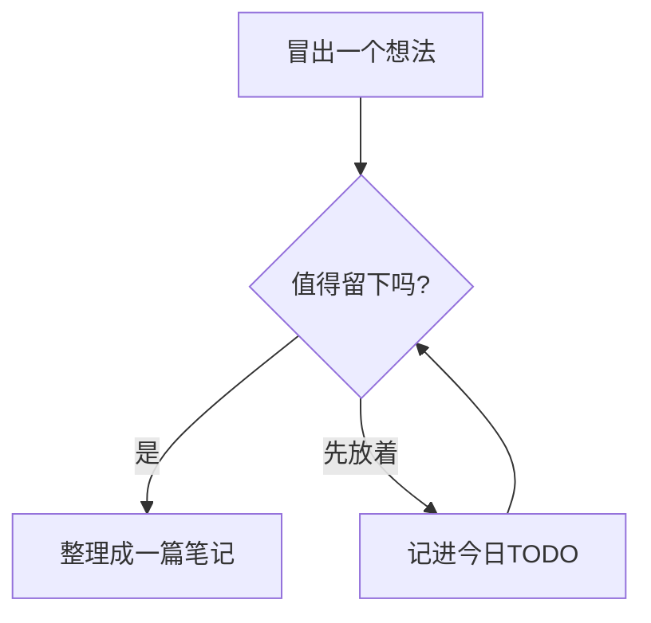
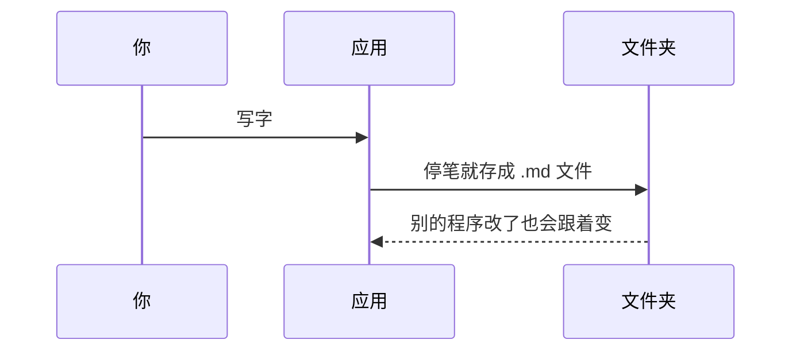
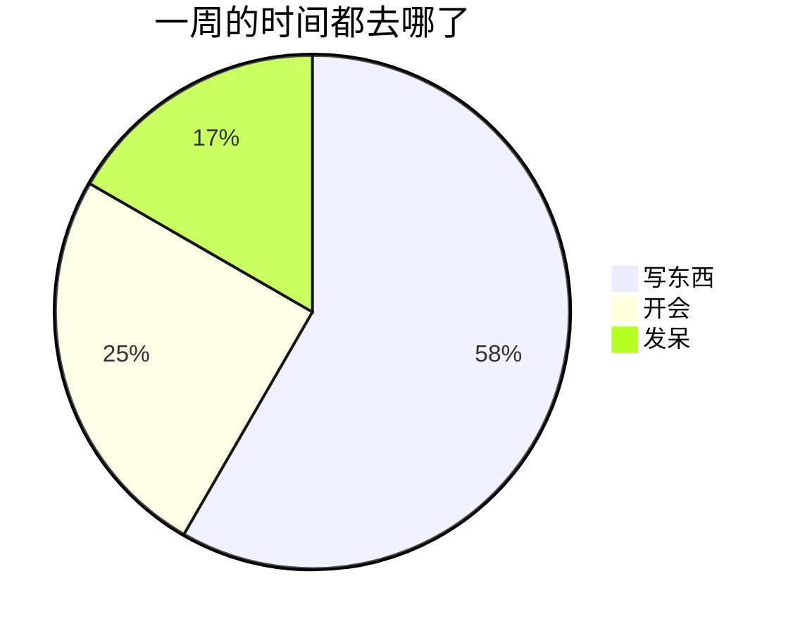

写的是 Markdown，看到的是排好版的样子：光标进到哪一段，那一段就露出源码；光标离开，标记折回去。下面每一节都是能直接改的例子，点进去就能看到源码是怎么写的。

不想记语法也没关系：行首输入 `/`（中文输入法下打 `、` 也行），从菜单里挑要插的东西；输入 `[[` 挑一篇笔记链过去。

[TOC]

## 标题

一个 `#` 是一级标题，两个是二级，最多六级：

### 三级标题

#### 四级标题

##### 五级标题

###### 六级标题

Ctrl+1 到 Ctrl+6 把这一行变成对应级别的标题，Ctrl+0 变回正文。

鼠标移到标题上，左边会出现一个小箭头：点一下，这一节就收起来，只留标题和后面的「… N 行」，再点一下展开。光标在哪一节里，按 Ctrl+Alt+[ 收起、Ctrl+Alt+] 展开；命令面板里还有「收起所有标题」「展开所有标题」。收起了哪些会记住，下次打开还是收着的，文件本身不会变。

右边的目录树也能收：有下级的条目左边有个小箭头，按住 Alt 点它连下面各层一起收。目录树收起来不影响正文。

## 行内样式

**粗体**、*斜体*、***粗斜体***、~~删除线~~、<u>下划线</u>、==荧光笔高亮==、`行内代码`、H<sub>2</sub>O 的下标、x^2^ 的上标、<kbd>Ctrl</kbd> + <kbd>K</kbd> 按键。

可以互相嵌套：**粗体里套 *斜体* 和 `代码`**，==高亮里套 **粗体**==。

常用的 HTML 标签也能用：<span style="color:#c8483d">红色的字</span>、<span style="background-color:#fff3b0">带底色的字</span>、<small>小字</small>、<big>大字</big>、<abbr title="Central Processing Unit">CPU</abbr>（悬停看全称）。

转义：在符号前面加反斜杠，它就只是个符号：\*不是斜体\*、\# 不是标题、\[不是链接\]、反斜杠本身 \\。

HTML 实体：&copy; 2026 &mdash; &ldquo;引号&rdquo; &hellip; &lt;tag&gt; &amp; &#8594;

智能标点：两个减号 -- 变成半破折号，三个 --- 变成全破折号，三个点 ... 变成省略号，(c) (r) (tm) 变成 © ® ™。代码里的 `--flag` 不会被动。

Emoji 短码：:smile: :rocket: :tada: :coffee: :white_check_mark:

动态表情会一直动，按 Ctrl+E 从选择器里挑（一共 48 个）：:odea_smile: :odea_fire: :odea_party: :odea_coffee: :odea_cat: :odea_666:

换行：行尾加两个空格  
或者一个反斜杠\
都能在同一段里另起一行。<br>写 `<br>` 也行。

<!-- 这是一条注释，光标不在这一行时只显示一个小标记 -->

## 链接

- 网页链接：[Odea](https://github.com "悬停时显示这句话")
- 引用式链接：[搜索][search]，地址写在文档的任何地方
- 直接写地址也会变成链接：<https://gitee.com>、https://github.com、www.example.com
- 邮件：<mailto:hello@example.com>

[search]: https://www.bing.com

链到另一篇笔记用双链，写笔记的标题就行：[[语法全览]]。还可以起个别名 [[语法全览|这一篇]]，或者直接跳到某一节 [[语法全览#数学公式|公式那一节]]。链到还没有的笔记会画成虚线，按住 Ctrl 点一下就新建一篇。

按住 Ctrl 再点：网页链接用浏览器打开，双链跳到那一篇。改了一篇笔记的标题，别处链到它的双链会跟着改。

## 脚注

脚注在正文里是一个小徽章[^1]，悬停能看到内容，点一下跳到定义，定义那里点一下再跳回来[^2]。同一个脚注可以引用好几次[^1]。

[^1]: 第一条脚注。
[^2]: 脚注的定义可以放在文档的任何地方，一般放在最后。

## 缩写

先定义一次，正文里出现的每一处都会带上虚线，悬停看全称：HTML 和 CSS。

*[HTML]: HyperText Markup Language
*[CSS]: Cascading Style Sheets

## 列表

- 无序列表用 `-`、`+` 或 `*` 开头
- 第二项
  - 前面空两格就是下一级
    - 再下一级
- 第三项

1. 有序列表的源码里可以全写 `1.`
1. 显示出来会自动编号
1. 第三项
   1. 嵌套的有序列表各自计数

起始编号取第一项的数字。和上一个列表之间要隔一段文字，只空一行的话会接成同一个列表：

3. 所以这里从 3 开始
3. 接着是 4

- [ ] 待办
- [x] 做完了的待办
  - [ ] 子任务也能勾

## 带日期的待办

待办后面写上日期，它就会出现在日历那一天的「当日安排」里，写在哪一篇都行：

```
- [ ] 交周报 @2026-10-09
- [ ] 力量训练 @2026-10-09 18:30 #健康
- [ ] 复盘 @2026-10-11 下午
```

日期写 `@年-月-日`；后面可以跟时间（`18:30`，或者 上午 / 中午 / 下午 / 晚上 / 全天）；第一个 `#标签` 是分类。在日历里勾掉，改的就是原文里的那一行。（上面的例子放在代码块里，所以不会真的进日历。）

## 定义列表

今日TODO
: 每天一篇，就是今天的日记

/GOAL
: 周、月、年目标，每个周期一篇

## 引用与提示块

> 一层引用
> > 两层引用

提示块是带标签的引用，`> [!标签]` 开头：

> [!提示]
> 小贴士，绿色。

> [!注意] 标签后面可以跟一个标题
> 黄色的提醒，里面也能写 **粗体**、`代码` 和 [链接](https://github.com)。

> [!重要]
> 紫色的重点。

> [!危险]- 默认收起的提示块
> 标签后面加 `-` 就默认收起，点徽章展开；加 `+` 是默认展开、可以收起。

> [!核心判断]
> 其他自己起的标签用这种样式：竖线加粗，正文放大一点。

认得的中文标签：笔记 / 说明 / 备注（蓝）、提示 / 技巧 / 建议（绿）、重要 / 关键（紫）、注意 / 警告（黄）、危险 / 错误（红）。英文的 NOTE、TIP、IMPORTANT、WARNING、CAUTION 也认。

## 代码

行内代码用反引号：`const x = 1`。

整块代码用三个反引号围起来，后面写上语言名就有语法高亮。光标不在代码块里时，右上角有「复制」按钮：

```python
def greet(name: str) -> str:
    return f"你好，{name}"

print(greet("Odea"))
```

```json
{ "name": "odea", "notes": 42, "synced": true }
```

语言名写 `csv` 或 `tsv`，显示出来就是表格：

```csv
名字,数量,备注
苹果,3,"红的, 甜的"
梨,5,
```

## 图表

语言名写 `mermaid`，画流程图、时序图、饼图：







写错了也不会出事，错误就地显示，点一下回到源码改。

## 表格

| 左对齐 | 居中 | 右对齐 |
|:-------|:----:|-------:|
| **粗体** | `代码` | [[语法全览]] |
| 多行<br>单元格 | :rocket: | ==高亮== |
| 竖线要转义：a \| b | ✅ | 100 |

分隔行里冒号的位置决定对齐。没写对齐、而且整列都是数字（可以带 ¥、$、千分位、小数、%）的，自动右对齐：

| 项目 | 预算 | 已花 | 进度 |
|-|-|-|-|
| 搬家 | ¥12,000 | ¥9,800 | 82% |
| 旅行 | ¥6,500 | ¥3,120.5 | 48% |

格子可以直接改：点进一格就露出这一格的源码。

- Tab / Shift+Tab：下一格 / 上一格，最后一格再按 Tab 在下面加一行
- Enter：下一行同一列；Shift+Enter 在格子里换行
- Ctrl+Enter：在下面插入一行
- Esc：回到正文
- 编辑时右上角有工具栏：插入、删除行和列，改对齐，回到源码

## 图片与附件


图片写 ``。说明后面加 `|420` 指定宽度，`|160x100` 指定宽和高。

最省事的是直接粘贴截图，或者把图片、文件拖进正文：文件会存进「附件」文件夹，正文里插入相对这一篇的路径，比如 ``。不是图片的文件插的是普通链接。

电脑里别处的图片写完整路径也行：``。

## 分隔线

三个 `-`、`*` 或 `_` 单独占一行：

---

## HTML

块级的 HTML 也能写，比如能折叠的一段：

<details>
<summary>点开看看</summary>
藏在里面的内容，<b>粗体</b> 和 <i>斜体</i> 都能用。
</details>

<div align="center">居中的一段字</div>

为了安全，脚本、内嵌网页和事件属性会被去掉，只显示安全的部分。

## 数学公式

行内公式用一个 `$` 围起来：质能方程 $E = mc^2$，欧拉公式 $e^{i\pi} + 1 = 0$。价格 $5 和 $10 不会被当成公式。

块级公式用两个 `$$`：

$$
\sum_{i=1}^{n} x_i = \int_0^1 f(x)\,dx
$$

$$
\begin{aligned}
a^2 + b^2 &= c^2 \\
e^{i\theta} &= \cos\theta + i\sin\theta
\end{aligned}
$$

## 目录

单独一行写 `[TOC]`，就换成这篇的目录，点一项滚到那一节（这篇开头那两段后面就有一个）。正文右边的「目录树」也一样能点。

## 模板

某一天和周 / 月 / 年目标里，一行只写 `/模板`，就会弹出这篇能用的模板：

- ↑ ↓ 挑一个，Esc 关掉
- Enter：把 `/模板` 这一行换成模板
- Shift+Enter：用模板替换全文，原来还没勾的待办收进最后的「待续」，一条不丢

模板按日期现算：周计划写好这一周七天的日期，复盘节点写成带日期的待办，会出现在日历上。普通笔记没有模板。

## 快捷键

| 操作 | Windows | macOS |
|:-----|:--------|:------|
| 一到六级标题 / 变回正文 | <kbd>Ctrl</kbd> + <kbd>1</kbd>…<kbd>6</kbd> / <kbd>0</kbd> | <kbd>⌘</kbd> + <kbd>1</kbd>…<kbd>6</kbd> / <kbd>0</kbd> |
| 标题升一级 / 降一级 | <kbd>Ctrl</kbd> + <kbd>=</kbd> / <kbd>-</kbd> | <kbd>⌘</kbd> + <kbd>=</kbd> / <kbd>-</kbd> |
| 收起 / 展开这一节 | <kbd>Ctrl</kbd> + <kbd>Alt</kbd> + <kbd>[</kbd> / <kbd>]</kbd> | <kbd>⌘</kbd> + <kbd>⌥</kbd> + <kbd>[</kbd> / <kbd>]</kbd> |
| 粗体 / 斜体 / 下划线 | <kbd>Ctrl</kbd> + <kbd>B</kbd> / <kbd>I</kbd> / <kbd>U</kbd> | <kbd>⌘</kbd> + <kbd>B</kbd> / <kbd>I</kbd> / <kbd>U</kbd> |
| 行内代码 | <kbd>Ctrl</kbd> + <kbd>Shift</kbd> + <kbd>&#96;</kbd> | <kbd>⌘</kbd> + <kbd>Shift</kbd> + <kbd>&#96;</kbd> |
| 删除线 | <kbd>Alt</kbd> + <kbd>Shift</kbd> + <kbd>5</kbd> | <kbd>Ctrl</kbd> + <kbd>Shift</kbd> + <kbd>&#96;</kbd> |
| 插入链接 / 图片 | <kbd>Ctrl</kbd> + <kbd>Shift</kbd> + <kbd>K</kbd> / <kbd>I</kbd> | <kbd>⌘</kbd> + <kbd>Shift</kbd> + <kbd>K</kbd> / <kbd>Ctrl</kbd> + <kbd>⌘</kbd> + <kbd>I</kbd> |
| 代码块 | <kbd>Ctrl</kbd> + <kbd>Alt</kbd> + <kbd>C</kbd> | <kbd>⌘</kbd> + <kbd>⌥</kbd> + <kbd>C</kbd> |
| 表格 | <kbd>Ctrl</kbd> + <kbd>T</kbd> | <kbd>⌘</kbd> + <kbd>⌥</kbd> + <kbd>T</kbd> |
| 引用 | <kbd>Ctrl</kbd> + <kbd>Shift</kbd> + <kbd>Q</kbd> | <kbd>⌘</kbd> + <kbd>⌥</kbd> + <kbd>Q</kbd> |
| 有序 / 无序列表 | <kbd>Ctrl</kbd> + <kbd>Shift</kbd> + <kbd>[</kbd> / <kbd>]</kbd> | <kbd>⌘</kbd> + <kbd>⌥</kbd> + <kbd>O</kbd> / <kbd>U</kbd> |
| 缩进 / 反缩进 | <kbd>Ctrl</kbd> + <kbd>]</kbd> / <kbd>[</kbd>，或 <kbd>Tab</kbd> / <kbd>Shift</kbd> + <kbd>Tab</kbd> | <kbd>⌘</kbd> + <kbd>]</kbd> / <kbd>[</kbd>，或 <kbd>Tab</kbd> / <kbd>Shift</kbd> + <kbd>Tab</kbd> |
| 清除格式 | <kbd>Ctrl</kbd> + <kbd>&#92;</kbd> | <kbd>⌘</kbd> + <kbd>&#92;</kbd> |
| 选中整行 | <kbd>Ctrl</kbd> + <kbd>L</kbd> | <kbd>⌘</kbd> + <kbd>L</kbd> |
| 查找 / 替换 | <kbd>Ctrl</kbd> + <kbd>F</kbd> | <kbd>⌘</kbd> + <kbd>F</kbd> |
| 动态表情 | <kbd>Ctrl</kbd> + <kbd>E</kbd> | <kbd>⌘</kbd> + <kbd>E</kbd> |
| 立即保存 | <kbd>Ctrl</kbd> + <kbd>S</kbd> | <kbd>⌘</kbd> + <kbd>S</kbd> |
| 打开链接 / 双链 | <kbd>Ctrl</kbd> + 点击 | <kbd>⌘</kbd> + 点击 |
| 命令面板 | <kbd>Ctrl</kbd> + <kbd>K</kbd> | <kbd>⌘</kbd> + <kbd>K</kbd> |
| 退出全屏编辑 | <kbd>Esc</kbd> | <kbd>Esc</kbd> |
